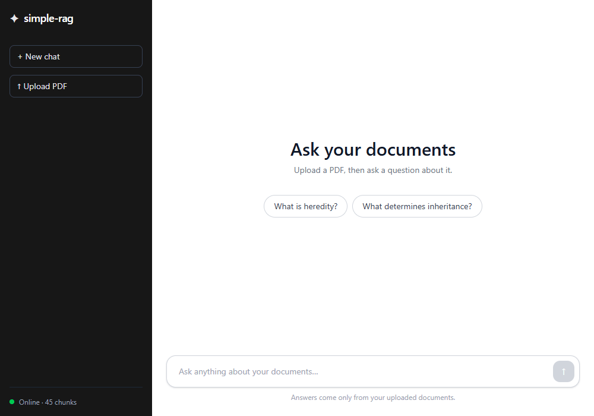

# simple-rag

An end-to-end **Retrieval-Augmented Generation (RAG)** application: upload a PDF, ask a question, and get a grounded answer with the source chunks shown beside it. Built step by step as a learning project toward agentic RAG.

## Demo



A tiny sample PDF is included at `docs/demo/sample-heredity.pdf` for a quick demo. The GIF above was captured from the real running app.

## Highlights

- **Local-first retrieval** — 1,024-dimensional `BAAI/bge-m3` embeddings run on your machine. No embedding API key, no quota, deterministic output.
- **Real vector search** — PostgreSQL + pgvector, cosine similarity, top-k results with source filename and chunk index.
- **Grounded answers** — grounded-only system prompt, 2,000-token context budget, and an explicit "I don't know" when the documents don't contain the answer.
- **Full-stack UI** — React + TypeScript + Tailwind chat interface with PDF upload, expandable source chips, and loading/error states.
- **One-click startup** — `start.bat` starts both servers and opens the browser.
- **Verified** — 8 passing API tests, strict TypeScript build, CLI and browser demos. Demo GIF included.

## Architecture

Embeddings and generation deliberately use different tools:

| Stage | Tool | Runs where | Needs API key? |
|-------|------|-----------|----------------|
| Embeddings | `sentence-transformers` + `BAAI/bge-m3` | Locally, on this machine | No |
| Generation | freellmapi → free cloud LLM providers | Local router, cloud inference | Yes (unified freellmapi key) |

- **Embeddings are local.** `BAAI/bge-m3` is MIT-licensed, 1,024-dimensional, supports 8,192-token inputs and 100+ languages. Weights are downloaded once (~2.2 GB) and cached.
- **Generation uses freellmapi**, a local router exposing one OpenAI-compatible endpoint at `http://127.0.0.1:31415/v1`. Only `LLM_*` settings apply to it.
- **Why split them:** retrieval quality should not depend on which LLM answers. Changing the chat model never requires rebuilding the vector store; changing the embedding model does, which is why it is pinned in `.env`.

```
INDEX:  PDF → clean text → token chunks → local vectors → pgvector
QUERY:  question → query vector → vector search → labeled context → LLM → answer + sources
```

## Tech stack

| Layer | Technologies |
|-------|--------------|
| Frontend | Vite, React, TypeScript (strict), Tailwind CSS |
| Backend | FastAPI, uvicorn, Pydantic |
| Retrieval | PostgreSQL + pgvector (embedded via `embedded-postgres`) |
| Embeddings | `sentence-transformers`, `BAAI/bge-m3`, `tiktoken` |
| Ingestion | `pdfplumber` |
| Generation | OpenAI SDK → freellmapi router |

All dependencies are free and open source (MIT / Apache-2.0 / BSD / PostgreSQL License / LGPL for the psycopg driver).

## Quick start

One-time setup, from the project folder:

```powershell
uv sync
Copy-Item .env.example .env
```

Open `.env` and replace `freellmapi-your-unified-key` with your real key. Python 3.14+, `uv`, and Node.js 22+ are required. `start.bat` installs frontend dependencies automatically on first run.

## Web app

Double-click **`start.bat`**. It starts the API and UI in two windows and opens:

- UI: `http://localhost:5173`
- API: `http://127.0.0.1:8000`

In the app: **Upload PDF** → wait for "Indexed … chunks" → type a question → press Enter → expand a **source** chip to see the exact chunk behind the answer.

## CLI

```powershell
uv run python main.py index "data\raw\your-file.pdf"
uv run python main.py ask "What is heredity?" --top-k 3
uv run python main.py chat --top-k 3
uv run python main.py context "What is heredity?" --top-k 3
uv run python main.py answer "What is heredity?" --top-k 3
```

`ask` returns chunks, `context` assembles the LLM context, `answer` runs the full RAG loop.

## API

| Method | Endpoint | Purpose |
|--------|----------|---------|
| `GET` | `/api/health` | Backend status and indexed chunk count |
| `POST` | `/api/index` | Upload a PDF (multipart `file`) and index it |
| `POST` | `/api/ask` | `{question, top_k, max_tokens}` → `{answer, sources}` |

## Project layout

```
backend/                  FastAPI application
frontend/src/             React UI (components, api client, types)
src/simple_rag/
  ingestion/              PDF loading and text cleaning
  chunking/               Token-based splitting
  embeddings/             Local bge-m3 embedder
  vectorstore/            pgvector store
  query/                  User question input and question embedding
  prompts/                Templates and context building
  generation/             LLM answer via freellmapi
  config.py               Settings from .env
  pipeline.py             CLI wiring all stages
tests/test_backend.py     API tests
docs/images/              Demo GIF
docs/demo/                Tiny sample PDF
start.bat                 One-click launcher
```

## Tests

```powershell
uv run pytest tests/test_backend.py -q     # 8 tests
cd frontend && npm run build && npm run lint
```

The tests cover health, grounded answers, source mapping, empty questions, LLM failures, empty indexes, non-PDF uploads, and sanitized filenames.

## Verified results

| Metric | Observed |
|--------|----------|
| Sample document | 6 pages, 3,823 tokens → 16 chunks |
| Embedding dimension | 1,024 |
| Top retrieved chunk similarity | 0.5656 (correct heredity section) |
| API tests passing | 8 |
| API endpoints | 3 |
| Context budget | 2,000 tokens |

## Limitations

- No chat history or conversation memory — "New chat" clears the thread.
- No token streaming; answers appear when complete.
- Image-only (scanned) PDFs require OCR, which is not implemented.
- Some source PDFs contain garbled glyphs from their original encoding; text is passed through unchanged.
- Runs locally only; no authentication or deployment configuration.

## Roadmap

- Conversation memory and multi-thread history
- Streaming answers in the UI
- Reranking and retrieval evaluation (recall@k)
- OCR for scanned PDFs
- Source citations with page-level references

---

Built with free and open-source tools.
